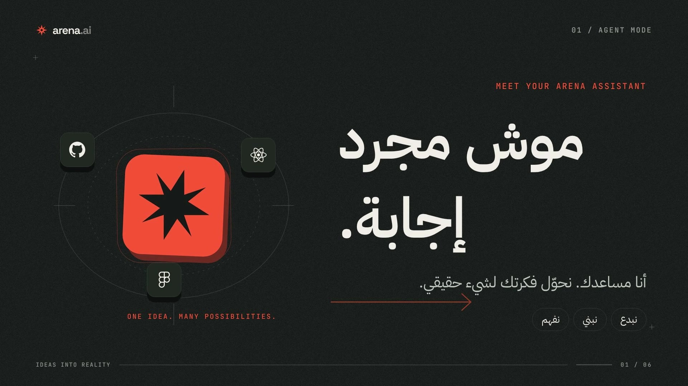

<div dir="rtl">

# Arena — الأفكار تصير واقع

</div>



**فيلم موشن جرافيك أصلي عن مساعد Arena.ai — 42 ثانية، 1920×1080، 30fps، عربي/إنجليزي، مع موسيقى أصلية.**

صُنع بالكامل باستخدام **Remotion + React + TypeScript**، مع مكونات فعلية من **RemotionUI**، خطوط Google مستضافة محلياً، وأيقونات شركات SVG. لا قوالب فيديو جاهزة، ولا موسيقى خارجية، ولا مؤثرات After Effects مزيفة: تم تطبيق مبادئ التصميم في كود قابل للتعديل وإعادة التصدير.

## شغّل المشروع

متطلبات التشغيل: Node.js 22+ وnpm. ملفات الفيديو والخطوط والصوت موجودة؛ لا تحتاج إلى مفتاح API.

```bash
npm ci
npm run dev
```

المعاينة: `http://localhost:3000`. فيها الفيلم النهائي، معاينة Remotion التفاعلية، الانتقال إلى الفصول، وتنزيل MP4.

```bash
npm run studio       # Remotion Studio على المنفذ 3001
npm run check        # فحص TypeScript
npm test             # اختبارات التوقيت، العربية، الخطوط، والصوت
```

## الملفات المسلّمة

| الملف | الوصف |
|---|---|
| [`deliverables/arena-agent-film.mp4`](deliverables/arena-agent-film.mp4) | النسخة النهائية: H.264 + AAC، 1080p، 42 ثانية |
| [`deliverables/poster.jpg`](deliverables/poster.jpg) | بوستر من إطار حقيقي في الفيلم |
| [`src/remotion/`](src/remotion/) | سورس الفيلم: ستة مشاهد، انتقالات، تايبوغرافي، ومكونات |
| [`app/`](app/) | واجهة مشاهدة عربية مبنية حول الفيديو وRemotion Player |
| [`public/audio/arena-score.wav`](public/audio/arena-score.wav) | الموسيقى الأصلية، 48kHz stereo |
| [`docs/RESEARCH.md`](docs/RESEARCH.md) | مصادر GitHub وX وAfter Effects، والأنماط والقرارات الفنية |
| [`docs/PRODUCTION.md`](docs/PRODUCTION.md) | التوقيت، البناء، التصدير، والمراجعة |
| [`.agents/skills/`](.agents/skills/) | مهارات Remotion الرسمية التي استُخدمت في التنفيذ |

## إعادة تصدير الفيلم

على جهاز فيه Chrome/Chromium مثبت:

```bash
npm run render:standard
```

في بيئة Linux مصغّرة، مثل حاوية بلا متصفح:

```bash
npm run render
```

الأمر الثاني يجهّز Chromium محلياً تحت `~/.cache`، ويبني اعتماد NSPR من المصدر الرسمي عند الحاجة. يحتاج إلى `git` و`gcc` و`make` لهذه الخطوة فقط. يمكن تجاوز التجهيز تلقائياً عبر تعيين `REMOTION_BROWSER_EXECUTABLE` إلى مسار متصفح موجود. لا تُحفظ المتصفحات أو أدوات التشغيل داخل Git.

التصدير يستخدم Remotion فعلياً، إطاراً بإطار، وليس تسجيل شاشة. إعدادات الجودة: H.264، CRF 18، `yuv420p`، وصوت AAC. المدة محسوبة من التايملاين مع خصم تداخل الانتقالات.

## عدّل الفيلم

- **النصوص والتوقيت:** `src/remotion/scenes/` و`src/remotion/lib/film.ts`.
- **الألوان والخطوط:** `COLORS` و`FONT` في `film.ts`، وتحميل الخطوط في `lib/fonts.ts`.
- **الحركة والانتقالات:** `components/Motion.tsx` و`ArenaFilm.tsx`.
- **الموسيقى:** `scripts/generate_audio.py`، ثم `python3 scripts/generate_audio.py` بعد تثبيت `numpy`.
- **الخطوط والأيقونات:** `node scripts/sync-assets.mjs` لإعادة نسخها من الحزم المقفلة في `package-lock.json`.

العربية تتحرك ككلمات/سطور مترابطة، لا كحروف منفصلة. لا توجد حركة CSS زمنية أو `Math.random()` داخل المشاهد؛ الإطار هو مصدر الحقيقة.

## الفصول

| الوقت | الفصل |
|---|---|
| 00:00 | الشرارة — موش مجرد إجابة |
| 00:05.5 | نفهم طلبك، نبحث، نرتّب الفكرة |
| 00:12 | من فكرة إلى كود إلى نتيجة |
| 00:19.5 | الحركة ليها معنى |
| 00:27 | نراجع، نحسّن، نسلّم |
| 00:33.5 | فكرتك الجاية، نبدأوها مع بعض |

## الترخيص والمصادر

الكود المضاف لهذا المشروع متاح تحت MIT؛ راجع [`LICENSE`](LICENSE). التراخيص الأصلية للمكونات والخطوط والأيقونات محفوظة في [`assets/licenses/`](assets/licenses/) و[`THIRD_PARTY_NOTICES.md`](THIRD_PARTY_NOTICES.md). علامات الشركات ملك لأصحابها وتستخدم للإشارة إلى الأدوات، وليس كادعاء شراكة أو تأييد. الشرارة الفنية في الفيلم ليست شعار Arena الرسمي.

تم الحفاظ على إعدادات Firebase و`dist/index.html` الأصليين. لم يُنشر الموقع على Firebase، ولم يُغيَّر مشروعه. معاينة المشروع الجديدة تعمل محلياً من جذر المستودع.
