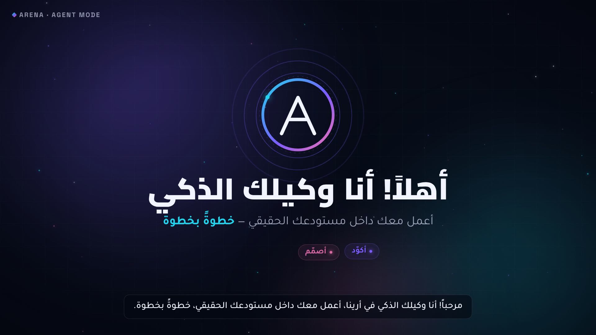
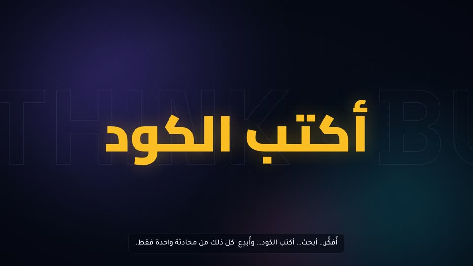
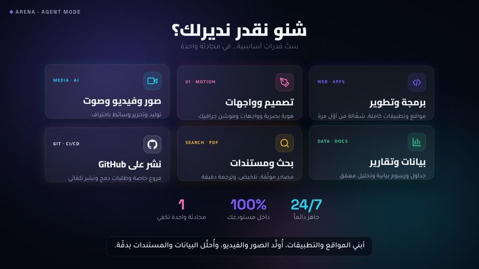
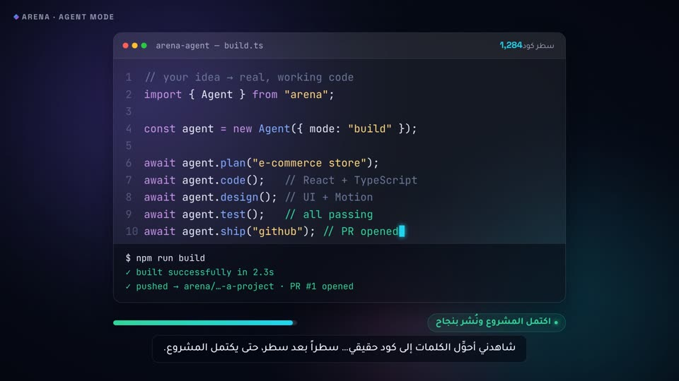
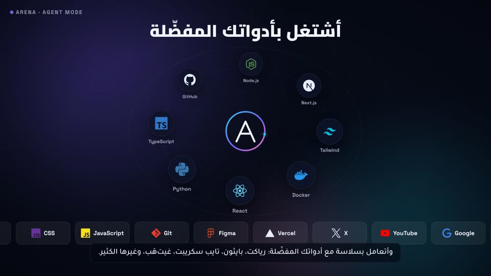
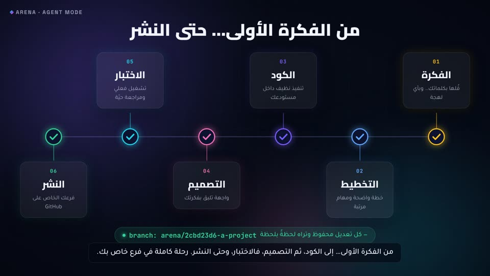
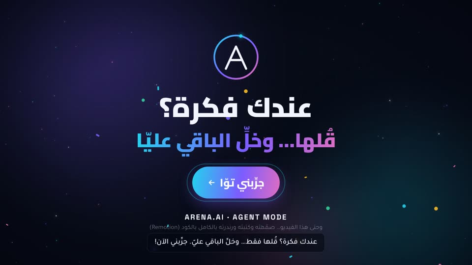

<div dir="rtl">

# 🤖 أنا وكيلك الذكي — فيديو موشن جرافيك بـ Remotion

فيديو تعريفي احترافي (66 ثانية · 1080p · تعليق صوتي عربي) عن وكيل Arena الذكي،
**مصنوع بالكامل بالكود**: كل فريم مرسوم بمكوّنات React عبر [Remotion](https://www.remotion.dev) — بدون أي برنامج مونتاج.

</div>



<div dir="rtl">

## ▶️ الفيديو

**[📽️ out/arena-agent.mp4](out/arena-agent.mp4)** — H.264 · ‏1920×1080 · ‏30fps · ‏66.2s · صوت AAC ستيريو (تعليق عربي + موسيقى مولّدة برمجياً + مؤثرات انتقال)

## 🎬 المشاهد

| # | المشهد | الأسلوب | الصورة |
|---|---|---|---|
| 1 | الهوك + كشف الشعار | Logo Draw-On + Motion Echo + جسيمات |  |
| 2 | أفكّر·أبحث·أكتب·أُبدع | Kinetic Typography + Parallax + Trails |  |
| 3 | شنو نقدر نديرلك؟ | Bento Grid زجاجي + عدّادات بيانات |  |
| 4 | الكود يُكتب حيّاً | محاكاة محرّر كود (Typewriter + طرفية) |  |
| 5 | أشتغل بأدواتك المفضّلة | مدار أيقونات SVG + شريط شعارات منساب |  |
| 6 | من الفكرة الأولى… حتى النشر | خط زمني يقود العين (RTL) |  |
| 7 | عندك فكرة؟ جرّبني توّا | Logo Stinger + زر CTA + قصاصات |  |

التفاصيل الكاملة للبحث (أساليب AE وGitHub وX + مكتبات Remotion UI): **[docs/motion-research.md](docs/motion-research.md)**

## 🚀 التشغيل

</div>

```bash
npm install
npm run studio        # معاينة تفاعلية (Remotion Studio) على http://localhost:3000
npm run render        # رندر MP4 إلى out/arena-agent.mp4 (ينزّل Chromium تلقائياً)
npm run render:sandbox # رندر بدون إنترنت: Chromium مضمّن من @sparticuz/chromium
npm run still         # صورة ثابتة (بوستر)
npm run typecheck
```

<div dir="rtl">

## 🧰 التقنيات والمهارات المثبّتة

- **Remotion 4.0.539** + مهاراته الرسمية (`npx skills add remotion-dev/skills` → `.agents/skills/` × 12 مهارة + `skills-lock.json`)
- **انتقالات رسمية** `@remotion/transitions`: ‏fade · slide · wipe · clockWipe · flip · iris
- **مكتبة UI حركية خاصة** بنمط RemotionUI/shadcn في `src/ui/` (بطاقات زجاجية، عدّادات، ترجمة سفلية، خلفية Aurora… إلخ)
- **خطوط Google Fonts محلياً**: Cairo · Tajawal · Space Grotesk · JetBrains Mono (من `@fontsource/*` إلى `public/fonts/`)
- **أيقونات شركات SVG**: ‏`simple-icons` (GitHub, React, Python, TypeScript, Docker… بألوانها الرسمية)
- **الصوت**: تعليق عربي مولّد (`public/audio/scene1-7.mp3`) متزامن فريم-بفريم + موسيقى وووش مولّدة بـ `scripts/make-audio.py` (numpy)

## 📁 البنية

</div>

```
src/
  Video.tsx            # TransitionSeries + الصوت + الترجمة
  Root.tsx · index.ts  # تسجيل التركيبة ArenaAgentVideo
  scenes/              # المشاهد السبعة
  ui/                  # primitives.tsx (مكتبة UI) + Logo.tsx
  lib/                 # timing.ts (مدد محسوبة من الصوت) · fonts.ts · theme.ts · brands.tsx
public/
  fonts/               # woff2 محلية (عربي/لاتيني)
  audio/               # تعليق 7 مقاطع + music.mp3 + whoosh.wav
scripts/
  make-audio.py        # توليد الموسيقى والمؤثرات (numpy)
  render-sandbox.mjs   # رندر في بيئات بلا تنزيل متصفح
out/arena-agent.mp4    # 🎬 الفيديو النهائي
docs/motion-research.md # 📚 بحث الأساليب والمكتبات والمصادر
.agents/skills/        # مهارات Remotion الرسمية المثبّتة
```

<div dir="rtl">

## 📝 ملاحظات

- مدد المشاهد في `src/lib/timing.ts` محسوبة من أطوال التعليق الحقيقية (61.6s)؛ الإجمالي بعد تداخل الانتقالات = **1986 فريم = 66.2s**.
- النص العربي يُحرَّك كلماتٍ مع `dir="rtl"` (أبداً حروفاً مفككة) وفق إرشادات مهارات Remotion الرسمية.
- الشعارات في مشهد الأدوات علامات تجارية لأصحابها؛ أيقوناتها من مشروع simple-icons.

</div>
